<p align="center">
  <picture>
    <source media="(prefers-color-scheme: dark)" srcset="branding/banner.png">
    <source media="(prefers-color-scheme: light)" srcset="docs/media/banner-light.png">
    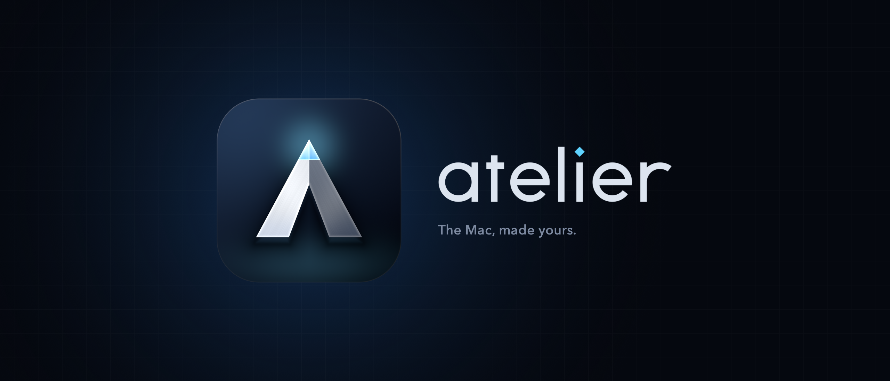
  </picture>
</p>

<p align="center">
  A free, open-source studio for shaping every part of macOS.<br>
  The light of the screen, the Dock, your windows, the sound, the menu bar.<br>
  With a live replica of your Mac to try it all on first.
</p>

<p align="center">
  <a href="https://github.com/kaizensx/Atelier/releases/latest"></a>
  <a href="https://github.com/kaizensx/Atelier/releases"></a>
  
  
  
  
</p>

<p align="center">
  <a href="#install"><b>Install</b></a>
  &nbsp;·&nbsp; <a href="#why-atelier"><b>Why Atelier</b></a>
  &nbsp;·&nbsp; <a href="#everything-it-does"><b>Features</b></a>
  &nbsp;·&nbsp; <a href="#safety"><b>Safety</b></a>
  &nbsp;·&nbsp; <a href="#build-from-source"><b>Build</b></a>
  &nbsp;·&nbsp; <a href="https://kaizensx.github.io/Atelier/"><b>Website</b></a>
</p>

<br>

<p align="center">
  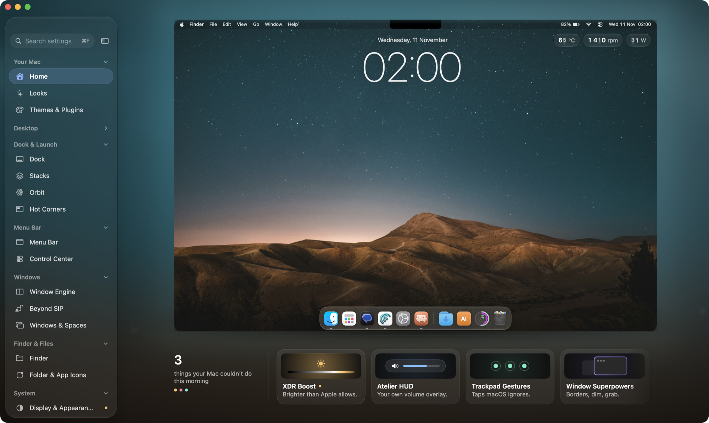
</p>

## Why Atelier

Most customisation apps flip switches macOS already has, one menu deeper. Atelier's headline
features do things a stock Mac cannot do at all. And every one of them can be undone.

<table>
  <tr>
    <td width="33%" valign="top">
      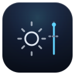<br>
      <b>Past Apple's limits</b><br>
      <sub>Brighter than Apple's maximum, darker than its minimum, warmer than Night Shift.</sub>
    </td>
    <td width="33%" valign="top">
      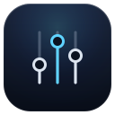<br>
      <b>Every app its own volume</b><br>
      <sub>Up to 150 %, its own speakers, and a 10-band EQ for everything you hear.</sub>
    </td>
    <td width="33%" valign="top">
      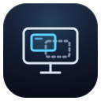<br>
      <b>Windows that remember</b><br>
      <sub>Plug a monitor back in and every window returns to where it lived on that setup.</sub>
    </td>
  </tr>
  <tr>
    <td width="33%" valign="top">
      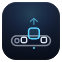<br>
      <b>A dock of your own</b><br>
      <sub>Ten designs, spring magnification, live tiles, gestures and window Peek.</sub>
    </td>
    <td width="33%" valign="top">
      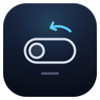<br>
      <b>Off means off</b><br>
      <sub>Every feature starts off. Switching it off, quitting or a crash puts the Mac back.</sub>
    </td>
    <td width="33%" valign="top">
      <br>
      <b>SIP stays on</b><br>
      <sub>Public APIs and documented calls. The one exception is opt-in and says what it costs.</sub>
    </td>
  </tr>
</table>

Nothing is faked. The readings come from the hardware, the numbers here were measured on a real
Mac, and the motion runs at the display's own rate, 120 Hz on ProMotion.

### Stock macOS and Atelier

| | Stock macOS | With Atelier |
|---|---|---|
| **Brightest SDR** | 600 nits on an XDR MacBook Pro | About 1,440 nits with XDR Boost |
| **Darkest** | The lowest brightness step | Below Black goes further |
| **Warmest** | Night Shift stops at 2,700 K | Candlelight goes down to 1,900 K |
| **Volume** | One for everything | Per app, up to 150 %, with its own output and EQ |
| **Switching desktops** | A slide of about a second | About 35 ms with Instant Spaces |
| **Fans** | macOS decides | Your own curve, handed back if anything goes wrong |
| **Unplugging a monitor** | Windows pile up and stay there | Every window goes back when the setup returns |
| **External monitors** | No control over third-party displays | Brightness, contrast, volume and input over DDC/CI |
| **Hot corners** | Four | Eight, each with its own modifiers and wait |
| **Dock** | One look | Ten designs, gestures, Peek and profiles |
| **Caps Lock** | Can become one other key | Hyper (⌃⌥⇧⌘) when held, Escape when tapped |
| **⌘Q** | Quits at once | Hold until the ring fills |

## A look inside

<table>
  <tr>
    <td width="50%">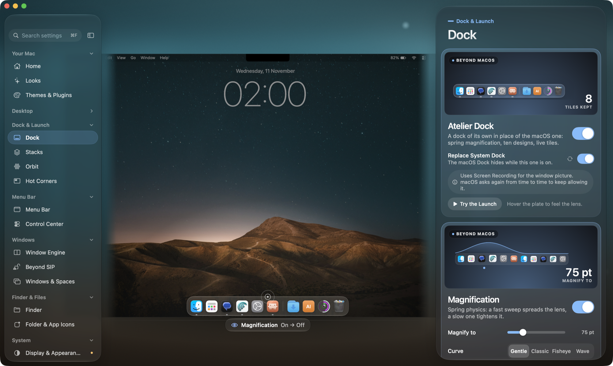<br><sub><b>Dock.</b> Ten designs, spring magnification, live tiles, gestures and window Peek.</sub></td>
    <td width="50%">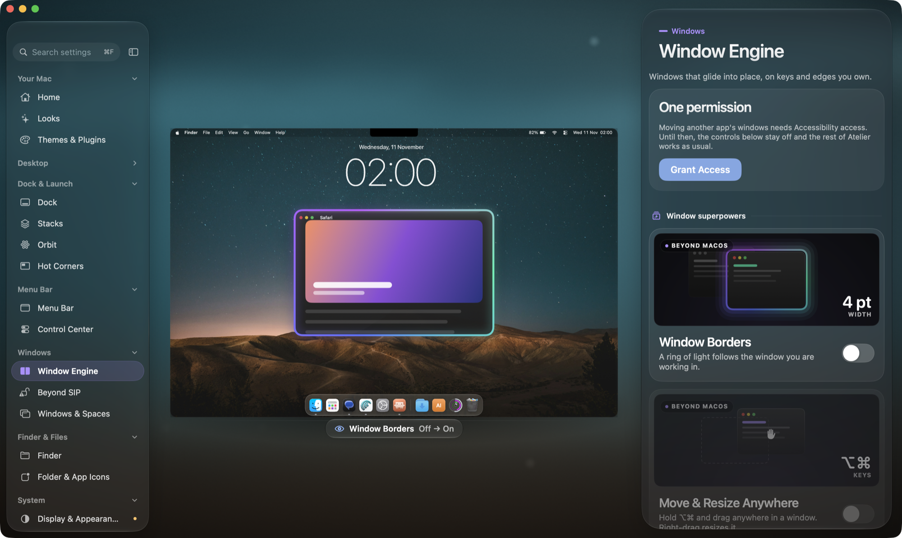<br><sub><b>Window Engine.</b> Snap, layouts, the radial menu, Edge Stash and Display Memory.</sub></td>
  </tr>
  <tr>
    <td width="50%">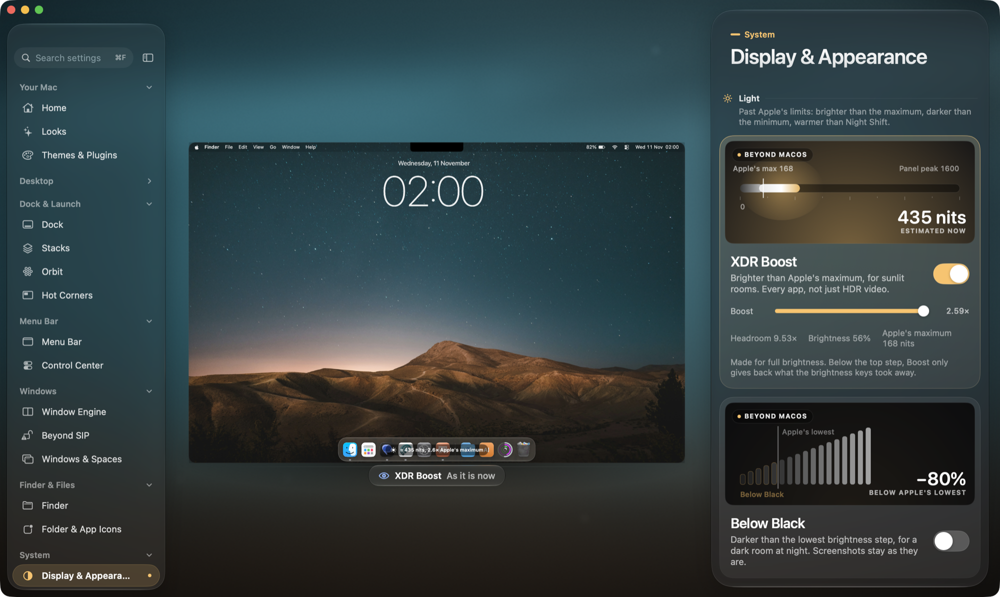<br><sub><b>Display.</b> XDR Boost, Below Black, Candlelight, Notch-Free and HiDPI on any monitor.</sub></td>
    <td width="50%">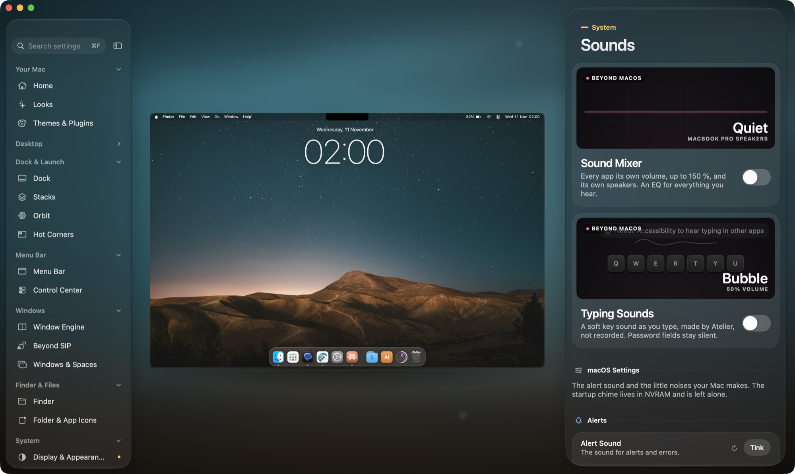<br><sub><b>Sounds.</b> Per-app volume up to 150 %, per-app output, and an EQ for everything.</sub></td>
  </tr>
  <tr>
    <td width="50%">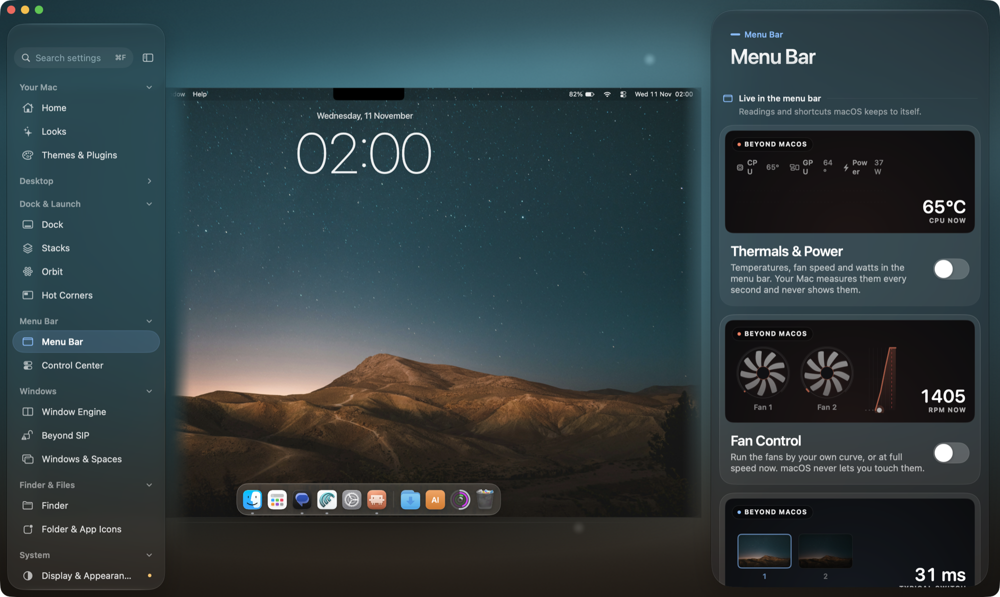<br><sub><b>Menu Bar.</b> Temperatures, fans and watts, Instant Spaces, a calendar and skins.</sub></td>
    <td width="50%"><br><sub><b>Home.</b> A live replica of your Mac, and a shelf of what a stock Mac cannot do.</sub></td>
  </tr>
</table>

## Install

<table>
  <tr>
    <td>

**1. Download** `Atelier-<version>.zip` from the [latest release](https://github.com/kaizensx/Atelier/releases/latest).

**2. Move** Atelier.app to `/Applications` after unzipping it.

**3. Open it once the long way.** Releases are code-signed but not notarized: notarization needs a
paid Apple Developer ID, and Atelier is a free project. So macOS asks once. Right-click Atelier.app,
choose **Open**, then **Open** again. Or try to open it, then click **Open Anyway** in
**System Settings › Privacy & Security**. In Terminal, this does the same:

```sh
xattr -dr com.apple.quarantine /Applications/Atelier.app
```

**4. Follow the Permissions screen.** It shows what each permission unlocks, puts Atelier in the
right macOS list with one button, and updates live as you grant them.

  </td>
  </tr>
</table>

You only do step 3 once. Updates arrive through Atelier itself, keep the same signature, and keep
the permissions you granted. Runs on macOS 14 Sonoma, 15 Sequoia, 26 Tahoe and 27, on Apple
silicon and Intel.

## Updates

Atelier updates itself from GitHub Releases. Open **Settings › Updates**.

- **Two channels.** **Stable** gets finished releases only. **Beta** gets every build first.
- **Beta first, always.** Every release ships as a beta, is tested on the maintainer's own Mac,
  and only then is the same code promoted to stable.
- **Signed and verified.** Each download is checked against an Ed25519 signature made with a key
  that never leaves the maintainer's Mac, then its code signature and version are checked. A
  download that fails any check is refused.
- **Roll Back.** The version you had is kept. **Roll Back** puts it back in one click.
- **Automatic checks.** With the switch on, Atelier looks every few hours. One click downloads,
  a second installs and relaunches.
- **Quiet.** Requests carry a generic `Atelier-Updater` User-Agent and nothing about you.

## Everything it does

Atelier is laid out like its sidebar. Every place has a short intro, its headline features first,
then macOS's own settings, so you never need System Settings and Atelier side by side. Rest the
pointer on almost any control and the stage previews it before you commit.

Open a chapter below. [docs/FEATURES.md](docs/FEATURES.md) lists every card and setting, the
permission each one needs, and its `atelier://` test hook.

<details>
<summary><b>Your Mac</b> &nbsp;<sub>Home, Looks, Mods</sub></summary>

<br>

| Feature | What it does | Stock macOS |
|---|---|---|
| **Home** | A live replica of your Mac, and a shelf of tiles for what a stock Mac cannot do. Hover a tile to play it on the stage. | No equivalent. |
| **Looks** | Curated themes in one click: Dock, menu bar, wallpaper, widgets and icon tint together. **Change with the Day** hands over from one Look to the next at the hour you set. Revert undoes the run. | No themes beyond Light, Dark and accent colour. |
| **Mods** | Community plugins, themes and data-only packs (icons, sounds, shaders, snap layouts, minimise effects, Looks) from a signed catalog on GitHub: browse, install, update and remove in one place. A mod's page shows where it lives once installed: its Dock tile, widgets, commands and corner actions, one click away. **Library** holds your own: create a theme from your Mac, import, and manage plugins and packs. A theme is one JSON file that restyles everything Atelier reaches; plugins add widgets (with buttons, charts and images), Dock tiles, commands, corner actions and their own settings in sandboxed JavaScript, and plug into the Command palette, the menu bar, Stacks, Scenes, live activities and small windows of their own. See [docs/README.md](docs/README.md). | No theme or plugin system. |

</details>

<details>
<summary><b>Desktop</b> &nbsp;<sub>Wallpaper, Live Wallpaper, Widgets, Effects</sub></summary>

<br>

| Feature | What it does | Stock macOS |
|---|---|---|
| **Generated Wallpaper** | Painted on the GPU at your display's exact size, and repainted as the light changes through the day. | Dynamic wallpapers only from Apple's set. |
| **Wallpaper Library** | Wikimedia Commons featured pictures, NASA's image library, Bing's daily image, and Unsplash with your own free key. A new one every day if you like. | No online sources. |
| **Live Wallpaper** | Eighteen Metal shaders, three of them made from your own picture. Runs at the display's rate and sleeps when nothing shows. Pause on battery. | Only Apple's video screen-saver wallpapers. |
| **Website Wallpaper** | Any web page as your desktop: a live map, a dashboard, an art piece. | Not possible. |
| **Widgets** | Twenty-seven kinds on a desktop board, from clocks, weather and vitals to reminders, habits and a launcher. Positions, sizes and styles are saved per display. | Fixed WidgetKit sizes, no system vitals. |
| **Effects** | Focus Light, Notch Shelf (drop files at the top of the screen), Menu Bar Hider, vignette, film grain, a scheduled night tint, edge glow, app pulse, pixel grid, ruler, colour picker and screen annotation. Every overlay is click-through. | None of these. |

</details>

<details>
<summary><b>Dock & Launch</b> &nbsp;<sub>Atelier Dock, Peek, Stacks, Orbit, Hot Corners</sub></summary>

<br>

| Feature | What it does | Stock macOS |
|---|---|---|
| **Atelier Dock** | A dock of its own in place of the macOS one: ten designs, spring-physics magnification, live tiles and rings, profiles that switch by desktop or time of day. Minimised windows fly into it, with a real Genie that follows your macOS setting or one of eight other effects. | One look, one dock. |
| **Dock Gestures & Live Peek** | Swipe up on a tile for that app's windows, down to minimise, pinch twice to quit. Window pictures with close and minimise buttons. | No gestures on Dock icons, no previews. |
| **Dock Peek** for the macOS Dock | Hover an app in Apple's Dock to see its windows. Swipe, pinch and scroll on its icons. No injection: SIP stays on. | No window previews. |
| **Stacks** | Folder bubbles and Smart Stacks that fill themselves from a search, in either dock. | Plain folder stacks only. |
| **Orbit** | Your apps in rings over any desktop, sorted by what each app does and searched by typing. | Launchpad, gone in macOS 26. |
| **Atelier Hot Corners** | Eight spots instead of four (corners and edge middles), each with its own action, modifier keys and wait. | Four corners, no modifiers per corner. |

</details>

<details>
<summary><b>Menu Bar</b> &nbsp;<sub>Thermals, Fan Control, Instant Spaces, Calendar, Skins</sub></summary>

<br>

| Feature | What it does | Stock macOS |
|---|---|---|
| **Thermals & Power** | CPU and GPU temperature, fan speed and the watts your Mac draws, with two minutes of sparklines a click away. Read only. | Measured every second, never shown. |
| **Fan Control** | Run the fans by your own curve, or flat out now. A small root helper does the writes; it hands the fans back to macOS if Atelier quits, hangs for 10 seconds, or the Mac sleeps. Opt-in, removable from the card. | No fan control at all. |
| **Instant Spaces** | Switch desktops with no slide, about 35 ms against a second for Control-Arrow. Send a window to another desktop from the keyboard, the menu bar or a drag. | Always animates; no "send to desktop" key. |
| **Spaces in the Menu Bar** | Which desktop you are on, as dots, numbers or your own names. Click to jump. | Not shown. |
| **Menu Bar Calendar** | Today's date, the month, week numbers and the day's events. Calendar access is asked for only when you turn events on. | Only a clock. |
| **Menu bar skins** | Gradients and materials painted behind the real menu bar, a night skin, and text kept readable. Plus a Day Line that fills as the day passes. | Not possible. |

</details>

<details>
<summary><b>Windows</b> &nbsp;<sub>Snap, Radial Menu, Edge Stash, Display Memory, Beyond SIP</sub></summary>

<br>

| Feature | What it does | Stock macOS |
|---|---|---|
| **Snap, layouts and hot keys** | Snap zones on edges and corners, custom zones you draw, layouts on ⌃⌥ keys, Window Shuffle, and named workspaces you restore later. | Basic tiling from macOS 15, no custom zones or workspaces. |
| **Radial Menu** | Hold ⌃⌥ (or Hyper, Right ⌥, Right ⌘, fn, or the middle button), flick the pointer, and the window lands there. | Not possible. |
| **Title Bar Gestures** | Two fingers on a title bar: swipe to tile, up to maximise, down to restore, pinch to close. Diagonals take the quarters. | No trackpad gestures for windows. |
| **Edge Stash** | Hold ⌘ and fling a window against the left or right edge. It waits as a glowing tab; point at it to slide it back. ⌃⌥⌘← / ⌃⌥⌘→ stash the front window, ⌃⌥⌘↓ brings everything back. | Not possible. |
| **Display Memory** | Plug in, unplug, wake, change resolution: every window goes back to where it was on that setup. | macOS piles windows on whatever screen is left and never puts them back. |
| **Move & Resize Anywhere** | Hold a chord and drag anywhere in a window to move it; right-drag to resize. | Only by the title bar and edges. |
| **Window Switcher** | Every window, not just every app, on a key you choose. | ⌘Tab switches apps only. |
| **Borders, Dim and Focus** | A ring of light around the window you are in, a shade over everything behind it, Stage Glow, and focus follows mouse. | None of these. |
| **Beyond SIP** (opt-in) | Window opacity, always on top, sticky windows on every Space, picture in picture for any window, no shadows, and Spaces you create and reorder. Needs SIP partly off and the Dock Bridge; see [Safety](#safety). | Reserved for the Dock itself. |
| **Windows & Spaces** | Mission Control, Spaces and Stage Manager settings, and the hidden switches behind them. | Spread across System Settings and `defaults`. |

</details>

<details>
<summary><b>Finder & Files</b> &nbsp;<sub>Finder, Folder & App Icons</sub></summary>

<br>

| Feature | What it does | Stock macOS |
|---|---|---|
| **Finder** | Finder's own preferences by section, then the hidden switches macOS keeps out of its settings. | Many need Terminal. |
| **Folder & App Icons** | Folders in any colour with a symbol, emoji or picture, and app icons from macOSicons.com. Every custom icon can be put back. | Paste-an-icon only. |

</details>

<details>
<summary><b>System</b> &nbsp;<sub>Display, Input, Sound, Every App</sub></summary>

<br>

| Feature | What it does | Stock macOS |
|---|---|---|
| **XDR Boost** | Brighter than Apple's maximum, in every app, not just HDR video. On recent XDR MacBook Pros it lifts the 600-nit SDR limit to about 1,440 nits at full brightness, using the headroom macOS keeps for HDR. | SDR tops out at 600 nits (500 on early XDR panels). |
| **Below Black** | Darker than the lowest brightness step, for a dark room at night. Screenshots stay as they are. | The lowest step is the floor. |
| **Candlelight** | Warmer than Night Shift can go, from 2,700 K down to 1,900 K. | Night Shift stops at 2,700 K. |
| **Notch-Free** | The built-in screen becomes 16:10 below the notch, with a true black band and the menu bar under it. Same size, same sharpness. | Only per-app "scale to fit below camera". |
| **Display Modes** | Every mode a display offers, hidden ones and every refresh rate included, with a 15-second "Keep this mode?" probation. | Hides most modes. |
| **HiDPI Anywhere & Virtual Screens** | Retina-sharp scaled sizes on monitors macOS calls low resolution, and headless virtual screens for sharing and recording. | HiDPI only on dense panels. |
| **External Monitors** | Real brightness, contrast, volume and input on your monitors over DDC/CI, on the keys, following the pointer. Software dimming for monitors that answer nothing. | No control over third-party monitors. |
| **Atelier HUD, Keyboard Light, Rounded Corners** | Your own volume and brightness overlay, the keyboard backlight with any idle time, and soft corners on every display. | Fixed overlay, short idle list, square corners. |
| **Trackpad Gestures & Haptics** | Three- and four-finger taps, top-corner taps, edge flicks and a firm press, each doing what you pick. Middle click with three fingers. A haptic click when a window snaps. | No setting for any of these. |
| **Hyper Key** | Caps Lock becomes ⌃⌥⇧⌘ when held and Escape when tapped. | Caps Lock can only become another single key. |
| **Mouse Precision, Wheel, Buttons** | Each mouse its own curve, linear included and faster than System Settings goes. A wheel that glides like a trackpad and can turn the other way. Side buttons for Back and Forward. | One speed and one scroll direction for everything. |
| **Sound Mixer** | Every app its own volume up to 150 %, mute and output device, and a 10-band EQ with its own curve per output. Apps left at 100 % on the default output are never touched. | One volume, one output, no EQ. |
| **Typing Sounds & Your Sounds** | A soft key sound made by Atelier (silent in password fields), and your own alert sounds. | Not possible. |
| **Hold ⌘Q to Quit** | A slip of ⌘Q does nothing. Keep it down until the ring fills. | Quits at once. |
| **Appearance** | Dark on your own hours, chosen apps kept light in Dark Mode, icon tint, and the hidden appearance switches. | Auto follows the sun only. |
| **Animations, Spotlight, Lock Screen, Accessibility Visuals, Every App, Quick Look** | macOS's own settings and hidden keys, each in one place, checked against what your macOS release reads. | Spread out or Terminal-only. |

</details>

<details>
<summary><b>Tools, History and Settings</b> &nbsp;<sub>Toolbox, Pin Window, Capture, Command, Scenes, Timeline</sub></summary>

<br>

| Feature | What it does |
|---|---|
| **Toolbox** | Text Grab (OCR any text on screen, read on this Mac), Screen Recorder with clicks and keys, Clipboard Actions, Quick Look Anything, Batch Rename, Image Converter, Finder toolbar buttons, Timers & Alarms, Focus Island beside the notch, and Focus Sessions that hide distracting apps. |
| **Pin Window** | A live copy of any window that floats above everything. |
| **Capture** | Where screenshots go, their name and format, plus the hidden switches. |
| **Command** | ⌥Space searches Atelier, your apps and your clipboard history. |
| **Scenes** | Save the whole Dock as a scene, apply it in one move, or let it switch at an hour. |
| **Timeline** | Every Dock change leaves a point to come back to. |
| **Settings** | Atelier's own look, shortcuts, Open at Login, **This Mac** (paste it into bug reports), **Updates**, and **Remove Everything**. |

</details>

<details>
<summary><b>Permissions</b> &nbsp;<sub>Asked for only when a feature needs one</sub></summary>

<br>

Atelier asks for a permission only when you turn on a feature that needs it, and says why on the
card. The first-launch Permissions screen shows live status, and a step-by-step fix when macOS
keeps a stale entry.

| Permission | Asked for by |
|---|---|
| **Accessibility** | Anything that moves windows or sees keys first: Window Engine, Title Bar Gestures, Radial Menu, Edge Stash, Display Memory, Move & Resize, Window Switcher, Focus Follows Mouse, Hyper Key, Atelier HUD, Hold ⌘Q, Typing Sounds, Wheel, Mouse Buttons, Dock Peek, Instant Spaces shortcuts, some Trackpad Gesture and Hot Corner actions. |
| **Screen Recording** | Window pictures in Live Peek and Dock Peek, minimise into the Atelier Dock, Pin Window, the Screen Recorder. Without it, Peek lists window titles. |
| **System Audio Recording Only** | Sound Mixer (macOS 14.2 or later). |
| **Calendars, Reminders** | Calendar events in the menu bar and the event and reminder widgets, only when you turn them on. |
| **Administrator password** | Installing the Fan Control helper, and the Dock Bridge for Beyond SIP. Both are removable from their cards. |

</details>

## Safety

- **Off by default.** A fresh Atelier changes nothing. Each feature waits for you to turn it on.
- **Off means off.** Turning a feature off removes its event tap, overlay or observer and puts
  back what it changed. Display tables return to ColorSync's own, the fans go back to macOS,
  stashed windows come back, a virtual screen disappears. If Atelier crashes, a small guard agent
  brings the macOS Dock back and relaunches it.
- **SIP stays on.** Everything outside Beyond SIP works with System Integrity Protection fully on,
  using public APIs and documented system calls. Dock Peek reads Apple's Dock from outside, with
  no injection.
- **Beyond SIP is opt-in, and honest about the cost.** The Dock Bridge (a scripting addition
  ported from yabai) needs SIP partly off: `csrutil enable --without fs --without debug --without nvram`,
  from recoveryOS. No app can change SIP, and Atelier does not try. Its Recovery Assistant walks
  you through it, warns that this lowers macOS protection, and removes the bridge with one click.
  `csrutil enable` turns SIP back on.
- **The fan helper is a choice.** It is installed only from the Fan Control card, with your
  administrator password, and removed the same way.
- **No telemetry, no accounts.** Atelier collects nothing. It goes online only for what you ask
  for: update checks, the weather city you pick, wallpaper and icon searches, themes you open by
  link, and plugins you allow the network. Requests use generic User-Agents.
- **One click to leave.** **Settings › Remove Everything** puts every macOS change back, deletes
  Atelier's data and quits.

Each feature checks what your Mac can do before it shows its controls, and says why when it
cannot ("Needs macOS 15", "Needs a Force Touch trackpad", "This Mac has no fan"). The full matrix
is in [COMPATIBILITY.md](COMPATIBILITY.md).

## Mods

Open **Mods** in Atelier to browse plugins and themes made by the community, from the catalog at
[kaizensx/atelier-mods](https://github.com/kaizensx/atelier-mods) and on
[the website](https://kaizensx.github.io/Atelier/mods.html). Every index is signed and every
package is checked before it is unpacked; plugins still ask for each permission. Packs are data
only: icon packs, sound packs, shader packs, snap layout packs, minimise effect packs and Looks,
each checked file by file before use. Your own live in **Mods › Library**: drop a
`.ateliertheme`, an `.atelierplugin` or a pack there to install it. The formats are in
[docs/THEMES.md](docs/THEMES.md), [docs/PLUGINS.md](docs/PLUGINS.md) and
[docs/PACKS.md](docs/PACKS.md), with examples in [`examples/`](examples).

## Build from source

You need Xcode 27 or later (Swift 6.4) and its Metal compiler. The app it builds runs on macOS 14
or later. The logic and tests (`DockCore`) also build with Xcode 26.

```sh
git clone https://github.com/kaizensx/Atelier.git
cd Atelier
swift test                  # unit tests for DockCore, the pure logic
zsh build.sh                # build/Atelier.app, universal (arm64 + x86_64)
zsh build.sh --install      # build, then replace /Applications/Atelier.app
```

`Sources/DockCore` holds pure logic with unit tests in `Tests/DockCoreTests`. `Sources/DockStacks`
is the app. `Native/` holds the Dock Bridge payload, `Shaders/` the Metal wallpapers. A local build
signs with an Apple Development identity if you have one, else ad hoc. Ad-hoc builds lose their
permissions on every rebuild.

Maintainers: [docs/RELEASING.md](docs/RELEASING.md) explains `scripts/release.sh`, the
test → beta → stable flow, the signing keys and how to rotate them.

## Contributing

Themes, plugins, fixes and reports are all welcome. Start with
[docs/CONTRIBUTING.md](docs/CONTRIBUTING.md), then [docs/THEMES.md](docs/THEMES.md) or
[docs/PLUGINS.md](docs/PLUGINS.md). New logic belongs in `DockCore`, with tests.

Found a bug? [Report it](https://github.com/kaizensx/Atelier/issues/new?template=bug_report.yml)
and paste the **This Mac** block from Settings. Reports from Macs other than the maintainer's are
very welcome. Have an idea? [Suggest it](https://github.com/kaizensx/Atelier/issues/new?template=feature_request.yml).

## Licence and credits

MIT. The Dock Bridge scripting addition is ported from [yabai](https://github.com/koekeishiya/yabai),
also MIT.

Atelier stands on what open projects worked out and shared. Techniques and ideas were learned
from, or inspired by:

- [MonitorControl](https://github.com/MonitorControl/MonitorControl), [m1ddc](https://github.com/waydabber/m1ddc)
  and [Lunar](https://github.com/alin23/Lunar): DDC/CI on Apple silicon, and sub-zero dimming.
- [BetterDisplay](https://github.com/waydabber/BetterDisplay): HiDPI and virtual displays.
- [Loop](https://github.com/MrKai77/Loop): the radial window menu.
- [yabai](https://github.com/koekeishiya/yabai): the Dock scripting addition and Spaces.
- [Stats](https://github.com/exelban/stats): reading the SMC and the chip's sensors.
- [AltTab](https://github.com/lwouis/alt-tab-macos): switching windows, not apps.

None of these projects is affiliated with Atelier.

<br>

<p align="center">
  <picture>
    <source media="(prefers-color-scheme: dark)" srcset="branding/logo/atelier-lockup-dark.png">
    <source media="(prefers-color-scheme: light)" srcset="branding/logo/atelier-lockup-light.png">
    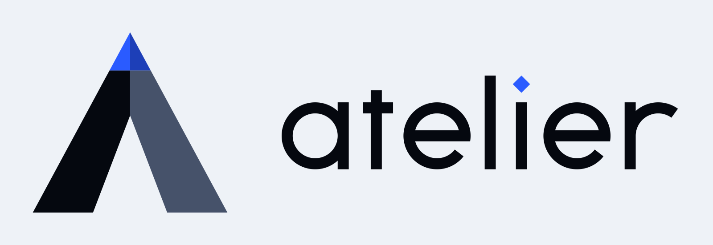
  </picture>
</p>

<p align="center"><sub>The Mac, made yours.</sub></p>
